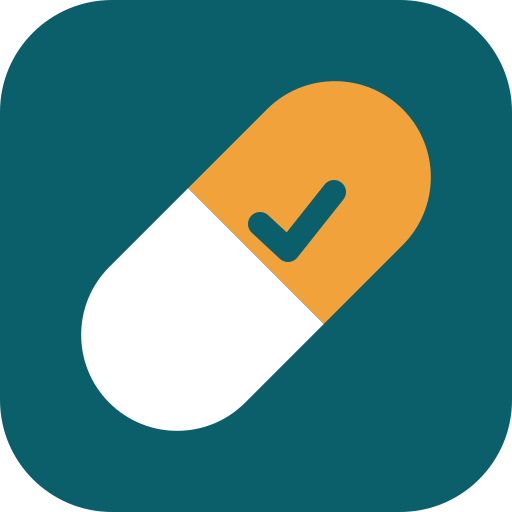

# Dose Certa



**Seu remédio na hora certa.** PWA mobile-first que ajuda uma pessoa a organizar seus medicamentos:
fotografar a receita → OCR local → revisão do usuário → agenda de doses com
lembretes → histórico → exportação em PDF.

Público principal: adultos e idosos, muitas vezes com pouca familiaridade com
tecnologia. Simplicidade e legibilidade vêm antes de qualquer recurso extra.

> Este app é um organizador e não substitui a orientação do seu médico ou
> farmacêutico. Confira sempre os dados com a receita.

## Stack

- React 18 + TypeScript + Vite
- Tailwind CSS 3 (mobile-first, 360–430px)
- React Router 6
- Dexie.js (IndexedDB) — **sem backend; sem `localStorage` para dados principais**
- Tesseract.js (idioma `por`), OCR 100% no navegador
- jsPDF + jspdf-autotable
- date-fns (locale `ptBR`)
- vite-plugin-pwa (manifest + service worker)
- Vitest (testes unitários)
- Fontes Nunito e Inter embutidas (`@fontsource`), sem Google Fonts

Todos os dados ficam apenas no aparelho. Nenhum dado é enviado a servidores.

## Identidade visual

Petróleo `#0B5F6B` (marca e botões), Âmbar `#F2A23A` (destaques, sempre com texto escuro), Menta `#E6F4F1`,
Grafite `#1F2D30` (texto), Cinza `#4B5B5E` (texto secundário) e Névoa `#F7FBFA` (fundo). Nunito Extra Bold nos
títulos, Inter nos textos e no mínimo 18 px. Regras completas em [`CLAUDE.md`](./CLAUDE.md#identidade-visual-dose-certa).

## Como rodar

```bash
npm install        # instala dependências (copia os arquivos do Tesseract via postinstall)
npm run dev        # servidor de desenvolvimento
npm run build      # typecheck (tsc -b) + build de produção em dist/
npm run preview    # serve o build (use para testar PWA/offline)
npm test           # Vitest (uma execução)
npm run icons      # regenera os ícones PNG do PWA
```

Pré-requisitos: Node.js 20+ e npm.

## Documentação do projeto

Este repositório é mantido por múltiplos desenvolvedores que trabalham **exclusivamente
com agentes de IA (Claude Code e similares)**. Antes de abrir sua primeira PR, leia,
nesta ordem:

1. [`CLAUDE.md`](./CLAUDE.md) — contexto do produto, modelo de dados, regras de
   segurança e decisões técnicas. É a fonte primária lida pelos agentes de IA.
2. [`CONTRIBUTING.md`](./CONTRIBUTING.md) — fluxo de branches, commits, Pull
   Requests e releases.
3. [`docs/architecture.md`](./docs/architecture.md) — padrão arquitetural adotado
   (camadas) e regras de dependência entre pastas.
4. [`docs/development-process.md`](./docs/development-process.md) —
   como um agente (coordenador, executor e revisor independente) deve planejar,
   implementar com TDD e validar o trabalho antes de abrir uma PR.
5. [`docs/coding-standards.md`](./docs/coding-standards.md) — nomenclatura,
   idioma do código (inglês) vs. idioma da interface (português), docstrings.
6. [`docs/adr/`](./docs/adr/) — registro das decisões arquiteturais (ADRs).

## Idioma

- **Código, nomes de arquivos, classes, funções, variáveis, comentários,
  commits, nomes de branch e títulos de PR: sempre em inglês.**
- **Interface exibida ao usuário final: sempre em português do Brasil.**
- Documentação de processo (este README, `CONTRIBUTING.md`, `docs/`, descrições
  de PR/issue): em português, para a equipe.

## Licença / aviso

Projeto interno, sem garantias.
